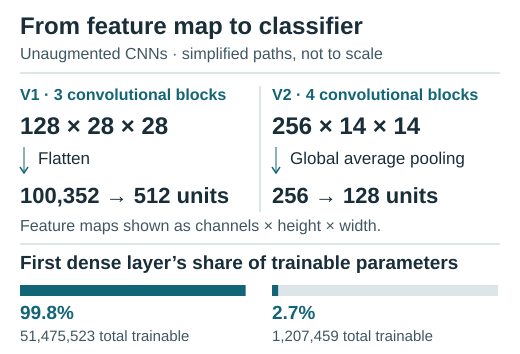
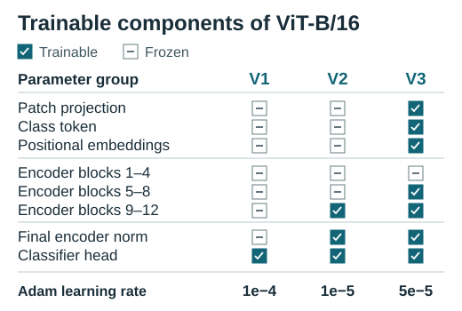

# Brain MRI classification for dementia severity

Coursework for the AI and Machine Learning component of the MSc Applied Bioinformatics at King's College London: a PyTorch and Google Colab investigation classifying 5,076 brain MRI images under three supplied labels, `MildImpairment`, `ModerateImpairment` and `NoImpairment`.

My initial hypothesis was that architectural sophistication would be a major driver of classification accuracy. I expected ViT-B/16 to outperform ResNet50, and both to outperform the custom CNN, without adapting their pretrained feature extractors to MRI. V1 therefore trained only replacement classification heads on the frozen ImageNet-pretrained backbones. ResNet50 and ViT-B/16 recorded 61.02% and 61.15% test accuracy, respectively, while the unaugmented CNN trained from scratch achieved the highest recorded accuracy of the investigation: 97.64% (744/762 images).

These results prompted two lines of investigation. Almost all of the original CNN's trainable parameters were concentrated in one dense layer, which led me to reconsider its architecture. A much smaller redesigned CNN performed considerably worse. The unexpectedly low performance of the frozen pretrained models also led me to introduce partial fine-tuning and subsequently extend the adaptation of the ViT, with the final V3 configuration achieving 95.54% (728/762 images).

Evaluation was image-level, with repeated test evaluation under a single deterministic split design throughout development. Patient-level independence could not be verified because patient identifiers were unavailable.

[V3 implementation (clean notebook)](notebooks/dementia_mri_classification_coursework_V3.ipynb) · [V3 recorded run with outputs](notebooks/dementia_mri_classification_coursework_V3_WithCellOutput.ipynb) · [Project overview and dataset](docs/project-overview.md)

## How the experiments changed

Recorded test-image classification accuracy:

| Experiment | V1 | V2 | V3 |
|---|---:|---:|---:|
| CNN, no augmentation | 97.64% | 46.98% | 46.98% |
| CNN, with augmentation | 71.39% | 46.19% | 47.90% |
| ResNet50 | 61.02% | 91.99% | 91.99% |
| ViT-B/16 | 61.15% | 87.53% | 95.54% |

Rows are experiment families whose configurations can change between versions. Equal V2 and V3 entries repeat recorded results for unchanged configurations under the same split design; they are not independent replications.

**Parameter placement.** In V1, 100,352 flattened features (128 × 28 × 28) fed a 512-unit layer holding 51,380,736 of the model's 51,475,523 trainable parameters. The V2 redesign used four convolutional blocks with batch normalisation and convolutional dropout, then global average pooling into a 128-unit head: 1,207,459 parameters. It ended at 50.45% training and 45.80% validation accuracy, consistent with underfitting under this setup. Extractor, normalisation, regularisation, pooling and head changed together, so the cause was not isolated. The final ViT trained 57,646,339 parameters, more than the original CNN.

*Unaugmented CNN baselines. Each strip spans all trainable parameters in its own model. The dark segment is the first dense layer, including its biases. The extractor and regularisation also changed.*

**Augmentation.** The V2 CNN experiments shared their architecture, initialisation seed and optimiser settings. Adding a pipeline of translation, scaling, intensity changes and blur changed the recorded test accuracy from 46.98% to 46.19%. This compares complete training pipelines under one recorded setup. In V3, stronger augmentation, including random erasing, was combined with reduced dropout, a wider head and a higher learning rate; its 47.90% cannot be attributed to augmentation alone. Only the second CNN experiment in each version used augmented training transforms. The final ViT used baseline transforms.

**Pretrained adaptation.** V1 trained only replacement heads on frozen ImageNet backbones. From V2, ResNet50 also fine-tuned parts of its later stages; the V2 notebook describes this partial fine-tuning as allowing adaptation from natural images to MRI. V2's ViT trained its last four encoder blocks, encoder layer norm and head at `1e-5`. V3 extended fine-tuning to the final eight encoder blocks, encoder layer norm, classification head, patch projection, class token and positional embeddings (67.0% of the model). Its learning rate of `5e-5` was five times the V2 ViT's rate and half the `1e-4` base rate. Accuracy increased from 87.53% to 95.54%, with these changes made together.

*Parameter trainability in the recorded ViT runs. Encoder blocks are numbered 1–12 from the input. The learning rate changed alongside the trainable components.*

[Full metrics by version](docs/experimental-development.md) · [Transforms and class weighting](docs/preprocessing-and-class-imbalance.md)

## Where the final ViT made errors

The final ViT misclassified 34 of 762 test images. Twenty-six were exchanges between mild and no impairment: 15 `MildImpairment` images were predicted as `NoImpairment`, and 11 `NoImpairment` images as `MildImpairment`. Of 109 `ModerateImpairment` images, 103 were classified correctly. These are observed disagreements with the supplied image labels. A biological or clinical explanation, or a general claim about which class is harder, would need other evidence.

## How the test set was used

A stratified split produced 3,552 training, 762 validation and 762 test images. Training images supplied the optimisation data, with inverse-frequency weighted loss and weighted random sampling on the training loader. Validation loss governed early stopping, and the best state was restored when the stopping branch triggered. Test images were evaluated after training within each experiment.

Split membership was regenerated deterministically for each run, so its identity across runs depends on unchanged dataset ordering; the original manifests are not in this repository. Without patient IDs, the results do not establish patient-level generalisation. There was no external, subgroup or clinical validation. Per-image confidence displays are uncalibrated softmax scores, distinct from aggregate accuracy.

[Split and evaluation details](docs/testing-and-evaluation.md) · [Limitations and lessons](docs/limitations-and-lessons.md)

## Inspect or rerun the notebooks

- V1, original CNN and frozen backbones: [clean notebook](notebooks/dementia_mri_classification_coursework_V1.ipynb) · [recorded run](notebooks/dementia_mri_classification_coursework_V1_WithCellOutput.ipynb)
- V2, redesigned CNN and partial fine-tuning: [clean notebook](notebooks/dementia_mri_classification_coursework_V2.ipynb) · [recorded run](notebooks/dementia_mri_classification_coursework_V2_WithCellOutput.ipynb)

Recorded outputs can be inspected without the data. A rerun needs the prepared three-class coursework dataset (not distributed here), a compatible Colab GPU runtime, a configured `DATA_DIR` and sequential execution; the original workflow mounted Google Drive. The public checkout alone cannot reproduce the results. Split files, model weights and figures are generated by a run.

[`filename_change.py`](filename_change.py) is a historical utility that prefixed image basenames with their class. It contains a machine-specific path and `DRY_RUN = False`; readers with prepared data can skip it.

[Workflow and reproducibility](docs/workflow-and-reproducibility.md)
